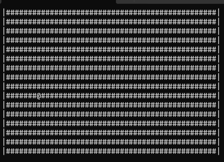

# Simulation-Prototyping

A C++ project exploring interactive fog, starting with an ASCII prototype and working toward a playable 3D voxel room. This README follows the project one stage at a time, documenting what I built, what I tested, and what I learned along the way.

## Stage 1 — Interactive fog in the console

I started with a small grid of fog densities. Each cell stores a value from `0.0` (clear) to `1.0` (full fog), and the console uses different ASCII characters to show how dense each cell is.

The finished prototype runs in real time. Move `@` with **WASD** to clear a path through the fog. The trail stays open briefly, then its edges soften and the fog gradually fills back in.

### How it developed

1. **Draw a grid.** I stored the cells in a flat `std::vector<float>` and used `row * gridWidth + column` to find a cell.
2. **Leave a trail.** I cleared one cell at a time along a scripted path and added a refill rule so the fog returned behind it.
3. **Let neighboring cells interact.** My first wake used fixed densities on either side of the player, which looked like a stripe. I replaced that with diffusion. Each interior cell moves partway toward the average density of its four neighbors.
4. **Tune the wake.** I added a two-tick hold after a cell is cleared and a separate refill rule that restores a fraction of the missing density each tick.
5. **Make it interactive.** I replaced the scripted path with real-time WASD input and buffered each console frame in a string before printing it.

### What I learned

I started with this prototype to see whether a simple grid could produce a convincing fog trail and to get an early sense of how viable the project was. 
Testing it in the console helped me understand how individual fog cells affect their neighbors and how diffusion and refill shape the wake behind the player. 
It also gave me a simulation I can carry over to later versions and test on larger, more complex grids.

One of the most important lessons was how much the order of updates matters.
If I changed densities in the same grid I was reading from, some cells would read values that had already changed during that tick.
I solved this by reading from the current grid and writing to a separate grid, so every cell uses the same starting state.

I noticed that the fog started filling in too quickly after the player passed, so I added a hold timer to each cell.
When the player clears a cell, it stays empty for two extra ticks while the surrounding fog continues to respond.
This made the trail easier to see and let me tune how long it stayed open independently of how quickly it filled back in.

